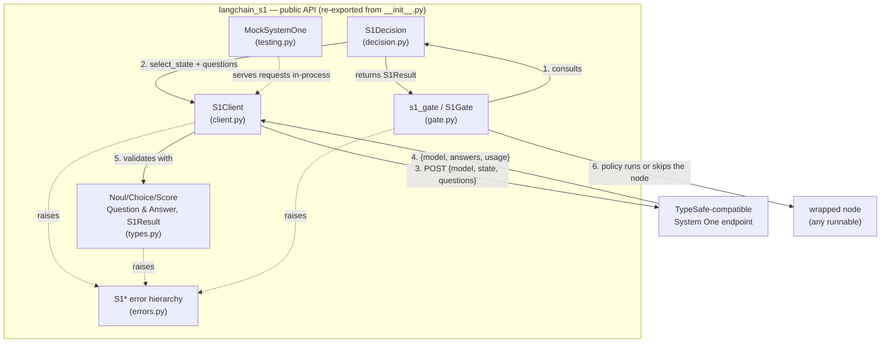

# Architecture

`langchain-s1` is a thin, typed layer between LangChain runnables and any endpoint
that speaks the [TypeSafe System One contract](https://docs.typesafe.ai/api/system-one):

```
request:  {model, state, questions}
response: {model, answers, usage}
```

Only text-based `noul`, `choice`, and `score` questions are supported.

## Code structure



## Layers

| File | Role | Depends on |
|---|---|---|
| `types.py` | The contract: typed questions (`NoulQuestion`, `ChoiceQuestion`, `ScoreQuestion`), typed answers (`NoulAnswer`, `ChoiceAnswer`, `ScoreAnswer`), `S1Result`, and field-by-field response validation. | `errors.py` |
| `client.py` | `S1Client`: builds the request body, sends it over `httpx` with bearer auth, retries (408/429/5xx, timeouts, connection errors) with exponential backoff, redacts URLs from messages, and hands the response to `types.parse_response`. | `types.py`, `errors.py` |
| `decision.py` | `S1Decision`: a LangChain `Runnable` that maps the runnable input through `select_state` (the only thing that leaves the process), calls the client, and returns an `S1Result`. Supports `invoke`/`ainvoke`/`batch`/`abatch` and `|` composition. | `client.py`, `types.py`, `errors.py` |
| `gate.py` | `s1_gate` / `S1Gate`: runs or skips an existing runnable based on `policy(decision(input))`. Provides `noul_policy`, `choice_policy`, the `GateAction`/`GateOutcome` types, `on_uncertain`/`on_error` fallbacks, and the `s1_gate` tracing event. | `decision.py`, `types.py`, `errors.py` |
| `errors.py` | Exception hierarchy: `S1Error` → configuration, unsupported-feature, inference (`S1RequestError`, `S1TimeoutError`, `S1APIError`, `S1ResponseError`), and `S1UncertainDecisionError`. | — |
| `testing.py` | `MockSystemOne`: an in-process `httpx.MockTransport` endpoint for tests and examples; no network or credentials. | — |
| `examples/quickstart.py` | A runnable, credential-free tour of the whole stack. | everything above |

## A request's life

1. **Select.** `S1Decision.select_state(input)` picks the view of the input that is
   sent to the endpoint. Everything else stays in the process.
2. **Coerce.** Questions are coerced to wire format (`types.coerce_questions`);
   unknown types and fields raise before anything is sent.
3. **Send.** `S1Client.decide` (or `adecide`) POSTs `{model, state, questions}` with
   `Authorization: Bearer …` when configured. Retries are bounded by `max_retries`
   with exponential backoff that honors `Retry-After`.
4. **Validate.** The response is validated field by field against the questions that
   were asked (`types.parse_response`): missing answers, mismatched types, unknown
   choices, out-of-range scores, and probabilities outside [0, 1] raise
   `S1ResponseError` with the offending field path.
5. **Decide.** Standalone, the `S1Result` is returned to the caller. Gated, the gate's
   policy maps the result to `run` / `skip` / `uncertain`; the wrapped node runs at
   most once, `skip_output` produces the output when skipped, and an `s1_gate`
   custom event records the outcome (never the credentials).

## Invariants

- Only what `select_state` returns crosses the wire; credentials never appear in
  messages, events, or `repr`s (URLs are redacted).
- The wrapped node in a gate is invoked at most once per gate invocation — only the
  inference request is ever retried.
- Every public answer is a typed object (`NoulAnswer`, `ChoiceAnswer`, `ScoreAnswer`),
  never a raw dict.
